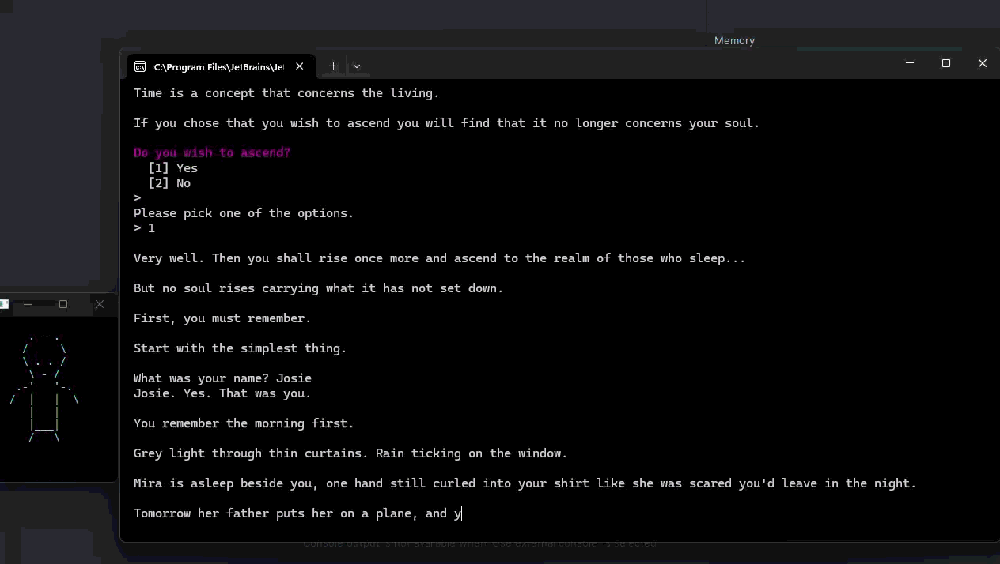

# Dev Log – The Death of You and Me

## gif showing game running

## What I planned

I already had C# experience, so a branching story with numbered input wasn't the hard part. I used the brief as an excuse to push what a plain console can do: ASCII art in its own window beside the story that changes as the story does, and typing effects that control the pacing of emotional scenes. The story is short: a girl's last morning with her girlfriend, Mira, the pact they make, and whether they rise to the heavens together or apart.

## Data structures and why

The story is a **graph**. Every scene is a `StoryNode` in a `Dictionary<string, StoryNode>`, and each `Choice` stores the id of the node it leads to. I chose a graph over a tree because my branches merge. The bakery and the pier both lead to the hill, and a tree would have meant duplicating scenes. A linked list was too linear for multiple endings. The dictionary gives instant lookup by id, and string ids kept the story readable while writing it. The trade-off is that a typo in an id only shows up at runtime, so `Play()` prints a "missing scene" message instead of crashing.

Choices sit in a `List<Choice>` because order matters: the index is the number the player types. The player's route is logged in a `List<string>` and shown at the end, and open art windows are tracked in a `Dictionary<string, Process>` so each one can be closed by name.

## The art windows

This was the biggest challenge. A console app only gets one window, so I relaunch the same exe through `conhost.exe` with an `--art` argument. When `Main` sees that flag, it draws the picture and does nothing else. The game passes its window handle and process id to the art process, so it can position itself with `SetWindowPos`, hand focus back with `SetForegroundWindow` so it doesn't steal keyboard input, and close when the story exits. Stopping orphaned windows was the fiddliest part. I kill them on scene changes, normal exit and Ctrl+C, and the art process also waits on the story process as a fallback.

## Typing and glitch effects

`Type()` prints one character at a time with a short sleep, and `Say()` waits for Enter after each line so the player reads at their own pace. `Glitch()` scrambles one line into another by redrawing it with `\r` and revealing the new text left to right, used for "I'm scared" becoming "I'm not scared anymore". It only works if the line never wraps, so those lines are kept short.

## Changes along the way

I added `AutoNext` so scenes without a decision move on by themselves. I also split `OnEnter` into `OnEnter` and `AfterLines`, because typed input like the player's name has to come after a scene's text, not before. Finally, I dropped the project from .NET 10 to .NET 8 so it would build on my machine.

## What I learned

Mostly Win32 interop through `DllImport`, managing several processes from one program, and how much pacing changes the feel of the same text.
